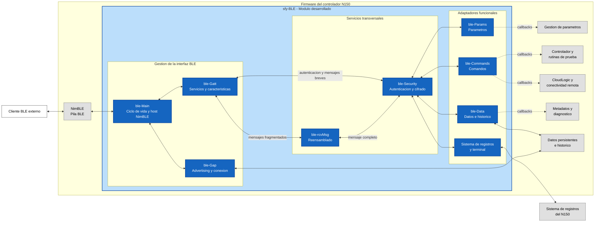

# Diagrama de arquitectura del sistema

Uso previsto: seccion 3.1, Arquitectura del sistema.

- El contenedor azul representa el componente desarrollado en este trabajo.
- Los bloques internos de `sfy-BLE` corresponden a los modulos de ciclo de vida, protocolo BLE, procesamiento, seguridad e integracion.
- Los bloques grises representan componentes preexistentes del firmware N150.
- Las lineas punteadas representan integracion mediante callbacks.
- Las lineas continuas representan dependencias directas de `sfy-BLE`.
- El diagrama representa el flujo funcional de procesamiento, no un diagrama estricto de llamadas entre archivos fuente.
- El cliente BLE se muestra fuera del limite del firmware porque no forma parte del desarrollo realizado.

Leyenda para la imagen final:

| Elemento | Significado |
|---|---|
| Azul | Componente desarrollado: `sfy-BLE` y sus bloques internos. |
| Gris | Subsistema preexistente del N150. |
| Linea punteada | Comunicacion mediante callbacks. |
| Linea continua | Dependencia directa del componente BLE. |
| Flujo central | Reensamblado, validacion de seguridad y entrega a los adaptadores funcionales. |

Caption sugerido: `Arquitectura general del firmware N150 e integracion del modulo sfy-BLE.`
